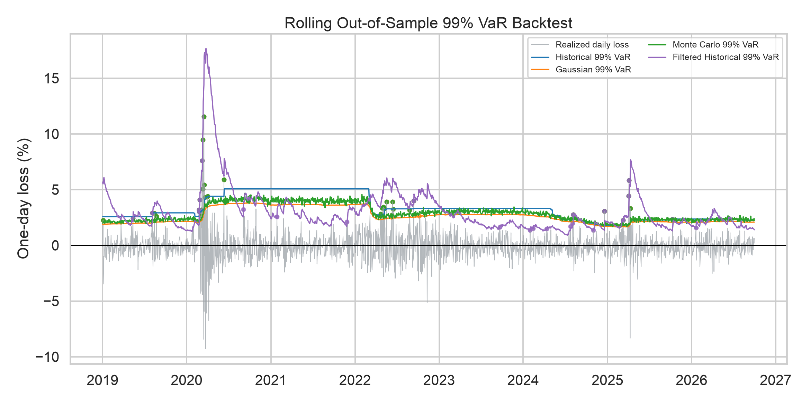
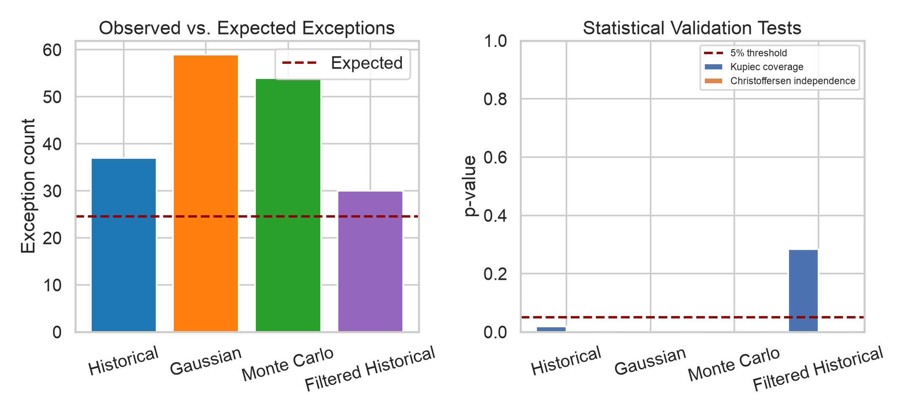

# Portfolio Risk Model Validation

A reproducible market-risk project that estimates and validates one-day
Value at Risk (VaR) and Expected Shortfall (ES) for an equal-weighted portfolio
of five U.S. industry portfolios.

The project compares historical simulation, Gaussian parametric risk, a
fat-tailed Monte Carlo challenger, and an adaptive filtered historical
simulation remediation model. It
then evaluates whether the forecasts
survive rolling out-of-sample backtesting, exception tests, sensitivity checks,
and explicit stress scenarios.

## Why this project

A risk estimate is not useful merely because it produces a number. It must be
documented, challenged against alternative approaches, and tested on outcomes
that were not used to fit it. This repository treats model validation as part
of the model rather than as an afterthought.

## Validation design

- Fixed, transparent portfolio weights across five industry return series.
- 500-day rolling estimation window with strictly lagged inputs.
- 99% one-day VaR and ES from four competing approaches.
- EWMA-filtered historical remediation when static-window models react too slowly.
- Kupiec unconditional-coverage and Christoffersen independence tests.
- Window and confidence-level sensitivity analysis.
- Deterministic, fat-tailed Monte Carlo simulation with a fixed seed.
- Named stress scenarios plus volatility/correlation stress.

## Repository structure

```text
src/portfolio_risk/      Data, risk, backtesting, and stress modules
scripts/                 Download and end-to-end analysis entry points
tests/                   Unit tests for calculations and edge cases
docs/                    Methodology, validation, and data documentation
reports/figures/         Reproducible charts
reports/tables/          Reproducible aggregate results
```

## Quick start

```bash
python3 -m venv .venv
source .venv/bin/activate
python -m pip install -r requirements.txt
python scripts/download_data.py
python scripts/run_analysis.py
python -m pytest
```

The source data are downloaded from the official
[Kenneth R. French Data Library](https://mba.tuck.dartmouth.edu/pages/faculty/ken.french/data_library.html)
and are not committed to this repository. See [`docs/data_source.md`](docs/data_source.md).

## Results

The locked analysis covers 2,953 daily portfolio returns from January 2015
through September 2026. The 500-day rolling design produces 2,453 genuinely
out-of-sample forecasts. At a 1% tail probability, approximately 24.5
exceptions are expected.

| Model | Exceptions | Kupiec p-value | Independence p-value | Finding |
|---|---:|---:|---:|---|
| Historical | 37 | 0.019 | <0.001 | Reject coverage and independence |
| Gaussian | 59 | <0.001 | <0.001 | Reject coverage and independence |
| Monte Carlo Student-t | 54 | <0.001 | <0.001 | Reject coverage and independence |
| Filtered historical | 30 | 0.283 | <0.001 | Coverage improves; clustering remains |

The remediation is therefore only a **partial success**. EWMA-filtered
historical simulation corrects the overall exception frequency, but exceptions
remain clustered during stressed regimes. The project records that limitation
instead of declaring the model validated.

Latest-window 99% risk estimates range from 1.40% to 2.32% VaR and from 2.40%
to 3.80% ES. Under the explicit volatility/correlation stress, VaR rises to
3.41% and ES to 3.92%.





See [`reports/executive_summary.md`](reports/executive_summary.md),
[`docs/methodology.md`](docs/methodology.md), and
[`docs/model_validation.md`](docs/model_validation.md) for interpretation and
limitations.

## Scope

This is an educational portfolio project, not investment advice or a production
risk engine. Daily industry portfolio returns are research aggregates, not
tradable instruments. Transaction costs, liquidity, intraday risk, changing
holdings, and regulatory capital rules are outside the current scope.

## License

Original code and documentation are released under the MIT License. The source
dataset remains subject to the terms and attribution of its provider.
